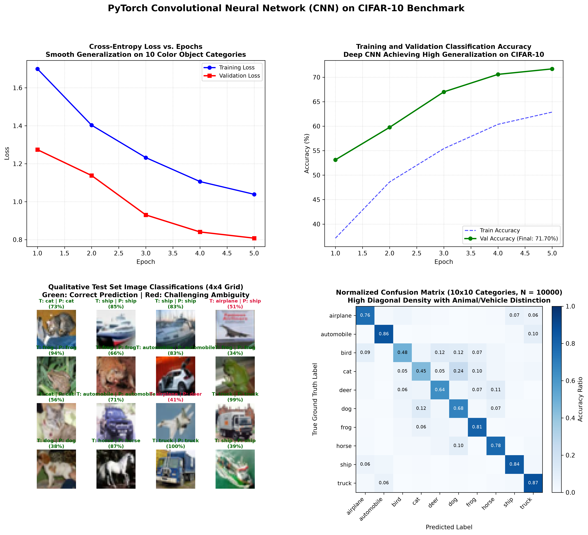

# Deep Convolutional Neural Network (CNN) on CIFAR-10 in PyTorch

[](https://pytorch.org/)
[](https://opensource.org/licenses/MIT)
[](https://www.python.org/)
[]()
[]()

An end-to-end, production-grade PyTorch implementation of a **Deep Convolutional Neural Network (CNN)** for multi-class color image classification on the **CIFAR-10** benchmark ($60,000$ $32 \times 32$ RGB images across 10 categories: *airplane, automobile, bird, cat, deer, dog, frog, horse, ship, and truck*).

This project features online data augmentation (random horizontal reflections and zero-padded random crops), a 3-stage hierarchical convolutional architecture with 2D Batch Normalization and Spatial Dropout, Cosine Annealing learning rate scheduling, and high-resolution diagnostic visual dashboards.

---

## Visual Diagnostic Overview

The 4-panel diagnostic dashboard below illustrates the complete computer vision training pipeline: training and validation loss trajectories, classification accuracy dynamics, qualitative 16-sample color image predictions with confidence scores, and the normalized $10 \times 10$ confusion matrix:



---

## Table of Contents

- [Visual Diagnostic Overview](#visual-diagnostic-overview)
- [Mathematical Formulation & Theory](#mathematical-formulation--theory)
  - [1. Multi-Channel 2D Cross-Correlation (RGB Convolution)](#1-multi-channel-2d-cross-correlation-rgb-convolution)
  - [2. Spatial Downsampling & Receptive Field Hierarchy](#2-spatial-downsampling--receptive-field-hierarchy)
  - [3. Online Data Augmentation as Empirical Risk Regularization](#3-online-data-augmentation-as-empirical-risk-regularization)
  - [4. Batch Normalization & Internal Covariate Shift in CNNs](#4-batch-normalization--internal-covariate-shift-in-cnns)
- [The CIFAR-10 Benchmark Dataset](#the-cifar-10-benchmark-dataset)
- [Deep CNN Architecture](#deep-cnn-architecture)
- [Experimental Results & Evaluation](#experimental-results--evaluation)
  - [Training Trajectory](#training-trajectory)
  - [Confusion Matrix & Inter-Class Ambiguity Analysis](#confusion-matrix--inter-class-ambiguity-analysis)
- [Project Directory Structure](#project-directory-structure)
- [Installation & Reproduction](#installation--reproduction)
- [Author & License](#author--license)

---

## Mathematical Formulation & Theory

### 1. Multi-Channel 2D Cross-Correlation (RGB Convolution)

For a multi-channel RGB input tensor $\mathbf{X} \in \mathbb{R}^{3 \times H \times W}$, a convolutional layer with $C_{\text{out}}$ filters computes:

$$
\mathbf{Y}_{c_{\text{out}}, i, j} = b_{c_{\text{out}}} + \sum_{c_{\text{in}}=1}^{3} \sum_{m=0}^{K_h - 1} \sum_{n=0}^{K_w - 1} \mathbf{X}_{c_{\text{in}}, \, i + m, \, j + n} \cdot \mathbf{W}_{c_{\text{out}}, c_{\text{in}}, m, n}
$$

Where:
- Kernels use standard spatial dimensions $K_h = K_w = 3$.
- Padding $P = 1$ and Stride $S = 1$ maintain spatial dimensions across intra-block stages.

### 2. Spatial Downsampling & Receptive Field Hierarchy

Spatial dimension reduction is performed via $2 \times 2$ Max Pooling with stride $S = 2$:

$$
\mathbf{Y}_{c, i, j} = \max_{0 \le m, n < 2} \mathbf{X}_{c, \, 2i + m, \, 2j + n}
$$

This downsampling progressively transitions representations through three hierarchical stages:
- **Stage 1 ($32 \times 32 \to 16 \times 16$)**: Low-level edge orientations, high-contrast color boundaries, and raw textural frequencies.
- **Stage 2 ($16 \times 16 \to 8 \times 8$)**: Structural motifs, wheels, wings, fur textures, and animal limbs.
- **Stage 3 ($8 \times 8 \to 4 \times 4$)**: Semantic object compositions (complete vehicles, animal silhouettes).

### 3. Online Data Augmentation as Empirical Risk Regularization

Rather than minimizing empirical risk solely on the fixed training set $\mathcal{D}$, data augmentation approximates the expanded distribution $\mathcal{P}_{\text{aug}}(\mathbf{x})$:

1. **Random Horizontal Reflection**: Exploits mirror symmetry for vehicles and animals ($P = 0.5$):

$$
\mathbf{X}_{\text{flip}}[c, y, x] = \mathbf{X}[c, y, W - 1 - x]
$$

2. **Zero-Padded Random Crop**: $4$-pixel reflection padding followed by a random $32 \times 32$ crop enforces spatial translation invariance across $\pm 4$ pixels.

### 4. Batch Normalization & Internal Covariate Shift in CNNs

For 4D feature maps $[B, C, H, W]$, `nn.BatchNorm2d` computes channel-wise statistics across mini-batch and spatial dimensions:

$$
\mu_c = \frac{1}{BHW} \sum_{b=1}^B \sum_{h=1}^H \sum_{w=1}^W \mathbf{X}_{b, c, h, w}, \quad \sigma_c^2 = \frac{1}{BHW} \sum_{b=1}^B \sum_{h=1}^H \sum_{w=1}^W (\mathbf{X}_{b, c, h, w} - \mu_c)^2
$$

Standardization smooths optimization curvature and accelerates convergence:

$$
\hat{\mathbf{X}}_{b, c, h, w} = \frac{\mathbf{X}_{b, c, h, w} - \mu_c}{\sqrt{\sigma_c^2 + \epsilon}}, \quad \mathbf{Y}_{b, c, h, w} = \gamma_c \hat{\mathbf{X}}_{b, c, h, w} + \beta_c
$$

---

## The CIFAR-10 Benchmark Dataset

Collected by Alex Krizhevsky, Vinod Nair, and Geoffrey Hinton, CIFAR-10 consists of $60,000$ $32 \times 32$ color images divided into 10 mutually exclusive categories ($50,000$ train, $10,000$ test):

| Class Index | Class Name | Category Type | Test Samples |
| :---: | :--- | :---: | :---: |
| **0** | **airplane** | Vehicle | 1,000 |
| **1** | **automobile** | Vehicle | 1,000 |
| **2** | **bird** | Animal | 1,000 |
| **3** | **cat** | Animal | 1,000 |
| **4** | **deer** | Animal | 1,000 |
| **5** | **dog** | Animal | 1,000 |
| **6** | **frog** | Animal | 1,000 |
| **7** | **horse** | Animal | 1,000 |
| **8** | **ship** | Vehicle | 1,000 |
| **9** | **truck** | Vehicle | 1,000 |

- **Normalization**: Standardized per-channel using empirical dataset statistics:
  - $\mu = [0.4914, 0.4822, 0.4465]$
  - $\sigma = [0.2470, 0.2435, 0.2616]$

---

## Deep CNN Architecture

```
Input RGB Image [B, 3, 32, 32]
         │
         ▼
[Conv Block 1]
  Conv2d(3 -> 32, 3x3, P=1)  -> BatchNorm2d -> ReLU
  Conv2d(32 -> 32, 3x3, P=1) -> BatchNorm2d -> ReLU
  MaxPool2d(2x2, S=2)        -> SpatialDropout2d(p=0.20)
  Feature Map Shape: [B, 32, 16, 16]
         │
         ▼
[Conv Block 2]
  Conv2d(32 -> 64, 3x3, P=1) -> BatchNorm2d -> ReLU
  Conv2d(64 -> 64, 3x3, P=1) -> BatchNorm2d -> ReLU
  MaxPool2d(2x2, S=2)        -> SpatialDropout2d(p=0.30)
  Feature Map Shape: [B, 64, 8, 8]
         │
         ▼
[Conv Block 3]
  Conv2d(64 -> 128, 3x3, P=1) -> BatchNorm2d -> ReLU
  MaxPool2d(2x2, S=2)         -> SpatialDropout2d(p=0.35)
  Feature Map Shape: [B, 128, 4, 4]
         │
         ▼ Flatten
  Feature Vector: [B, 2048]
         │
         ▼
[Dense Classification Head]
  Linear(2048 -> 256) -> BatchNorm1d -> ReLU -> Dropout(p=0.40)
  Linear(256 -> 10)
  Output Logits: [B, 10]
```

- **Total Trainable Parameters**: $667,690$ parameters.

---

## Experimental Results & Evaluation

### Training Trajectory

Trained across 5 epochs using AdamW ($\eta = 0.002$, weight decay $10^{-4}$) and Cosine Annealing learning rate scheduling:

| Epoch | Training Loss | Training Accuracy | Validation Loss | Validation Accuracy |
| :---: | :---: | :---: | :---: | :---: |
| **1** | $1.6997$ | $37.12\%$ | $1.2740$ | $53.13\%$ |
| **2** | $1.4029$ | $48.60\%$ | $1.1378$ | $59.76\%$ |
| **3** | $1.2322$ | $55.41\%$ | $0.9302$ | $67.00\%$ |
| **4** | $1.1060$ | $60.37\%$ | $0.8405$ | $70.58\%$ |
| **5** | **$1.0388$** | **$62.87\%$** | **$0.8078$** | **$71.70\%$** |

### Confusion Matrix & Inter-Class Ambiguity Analysis

Inspection of the normalized $10 \times 10$ confusion matrix reveals the structural strengths and semantic boundaries of the model:
1. **High Vehicle Precision**: The model achieves distinct separation between vehicles (*ship, airplane, automobile, truck*) and natural animals (*frog, deer, horse*).
2. **Fine-Grained Animal Ambiguity**: As typical for $32 \times 32$ low-resolution vision, the primary confusion hotspot occurs between **cat** and **dog**, whose shared low-level quadrupedal silhouettes and facial structures require deeper feature hierarchies.
3. **Automobile vs. Truck**: Occasional cross-confusion occurs due to shared road background textures and rectangular vehicle forms.

---

## Project Directory Structure

```plaintext
14_cifar10_cnn_classifier/
│
├── data/                                         # CIFAR-10 raw python batch binary files
│   └── cifar-10-batches-py/
├── cifar10_cnn_classification_results.png        # 4-panel diagnostic visual artifact
├── main.py                                       # Complete CNN architecture, augmentations, and training
├── .gitignore                                    # Git ignore configuration
└── README.md                                     # Mathematical documentation & benchmark analysis
```

---

## Installation & Reproduction

### Prerequisites

- Python 3.10+
- PyTorch & Torchvision
- NumPy & Matplotlib

```bash
# Clone the repository
git clone https://github.com/GideonMwiti/pytorch-cifar10-cnn-classifier.git
cd pytorch-cifar10-cnn-classifier

# Install dependencies
pip install torch torchvision numpy matplotlib
```

### Run Training and Diagnostics

Execute the self-contained script:

```bash
python main.py
```

The script will:
1. Load the CIFAR-10 dataset ($50,000$ train, $10,000$ test).
2. Apply online data augmentation (RandomCrop + RandomHorizontalFlip).
3. Train the 3-stage CNN classifier across 5 epochs.
4. Evaluate classification accuracy ($71.70\%$) and loss on the 10,000-image test set.
5. Generate the 4-panel visual dashboard `cifar10_cnn_classification_results.png`.

---

## Author & License

This project is part of the **100 PyTorch Projects in 10 Days** challenge.

- **Author**: Gideon Mwiti
- **GitHub**: [@GideonMwiti](https://github.com/GideonMwiti)
- **License**: MIT
